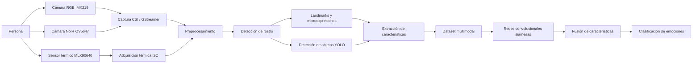
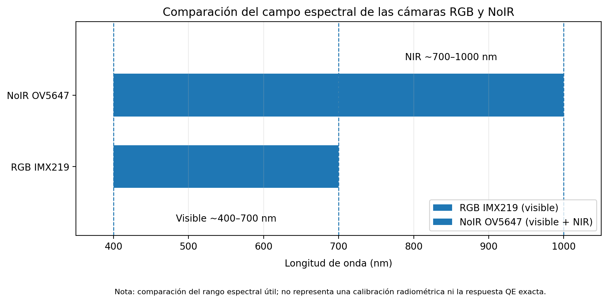
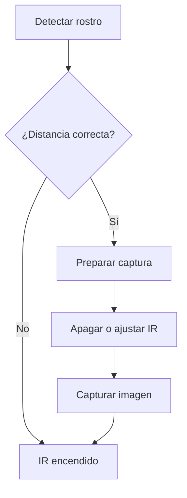
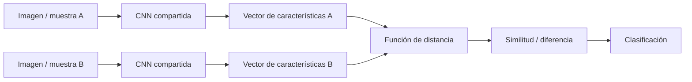

# Clasificación de Video RGB, NoIR y Termográfico mediante Redes Convolucionales Siamesas

## Descripción del proyecto

Este proyecto tiene como objetivo desarrollar un sistema de inteligencia artificial capaz de analizar información visual y térmica para apoyar el reconocimiento de emociones humanas. La propuesta utiliza una arquitectura multimodal compuesta por una cámara RGB, una cámara NoIR y un sensor térmico, procesando cada fuente de información de manera independiente antes de realizar una integración de características.

El sistema se ejecuta principalmente sobre una **NVIDIA Jetson Nano**, donde se realizan tareas de adquisición de video, procesamiento de imágenes, detección de rostros, extracción de características faciales, pruebas de detección de objetos y generación de un conjunto de datos propio.

La finalidad es construir una base experimental que permita entrenar posteriormente **redes neuronales convolucionales siamesas**, utilizando tanto características visuales como variaciones térmicas para comparar patrones asociados con diferentes emociones y microexpresiones.

---

## Objetivos

### Objetivo general

Desarrollar un sistema multimodal para la adquisición, procesamiento y clasificación de información RGB, NoIR y térmica orientado al análisis de emociones humanas mediante redes convolucionales siamesas.

### Objetivos específicos

- Capturar video de manera simultánea utilizando cámaras RGB y NoIR.
- Integrar información térmica mediante el sensor MLX90640.
- Analizar las diferencias entre el espectro visible y el infrarrojo cercano.
- Detectar y localizar rostros en tiempo real.
- Extraer puntos y características faciales relevantes.
- Identificar microexpresiones y cambios en regiones como cejas y boca.
- Registrar condiciones adicionales como lentes, barba y cabello sobre la frente.
- Crear un dataset propio con imágenes y metadatos.
- Evaluar detección de objetos mediante YOLO.
- Desarrollar una arquitectura de redes siamesas para comparar características.
- Integrar las diferentes modalidades en un modelo multimodal.

---

## Arquitectura general del sistema



---

## Hardware utilizado

| Componente | Modelo | Función |
|---|---|---|
| Computadora embebida | NVIDIA Jetson Nano | Procesamiento principal del sistema |
| Cámara RGB | Sony IMX219 | Captura de información en espectro visible |
| Cámara NoIR | OmniVision OV5647 | Captura visible + infrarrojo cercano |
| Sensor térmico | MLX90640 | Captura de distribución térmica |
| Iluminación IR | Módulo infrarrojo | Apoyo para captura con la cámara NoIR |
| Computadora externa | Laptop | Visualización, comunicación y pruebas |

---

## Cámaras utilizadas

### Cámara RGB — Sony IMX219

La cámara RGB se utiliza como referencia principal para capturar características visibles del rostro. El sensor IMX219 cuenta con una resolución de hasta **3280 × 2464 píxeles** y utiliza una matriz de color RGB.

En una cámara RGB convencional, el filtro de corte infrarrojo reduce la contribución de radiación IR para mantener una reproducción de color adecuada. Para este proyecto se utiliza principalmente para analizar:

- Color y textura facial.
- Forma de ojos y cejas.
- Movimiento de labios.
- Expresiones faciales.
- Lentes.
- Barba.
- Cabello sobre la frente.
- Información visual utilizada por los algoritmos de detección.

### Cámara NoIR — OmniVision OV5647

La cámara NoIR utilizada en el proyecto está basada en el sensor **OV5647 de 5 MP**. A diferencia de una cámara RGB convencional, la versión NoIR no utiliza un filtro de bloqueo infrarrojo, por lo que puede captar luz visible y una parte del infrarrojo cercano.

Esta característica permite estudiar información que no siempre se observa de la misma manera en una cámara RGB convencional.

Durante las pruebas se trabajó con:

- Ajustes de ganancia.
- Compensación de exposición.
- Iluminación infrarroja externa.
- Diferentes filtros de visualización.
- Corrección de orientación.
- Comparación directa con la cámara RGB.

La interfaz de referencia utilizada para estas pruebas es **NOIR FILTER LAB v8.1**, implementada en el archivo `noir_interface_v8_1.py`.

---

## Comparación del campo espectral RGB vs NoIR

La principal diferencia entre las dos cámaras se encuentra en el rango de radiación que puede llegar al sensor.

| Cámara | Sensor | Región utilizada en el proyecto |
|---|---|---|
| RGB | Sony IMX219 | Principalmente visible, aproximadamente 400–700 nm |
| NoIR | OmniVision OV5647 | Visible + infrarrojo cercano, aproximadamente 400–1000 nm |

> **Importante:** esta comparación representa el rango espectral útil de las cámaras y no una calibración radiométrica. La respuesta exacta del sensor depende de la óptica, filtros, iluminación, configuración de exposición y características específicas del módulo.

### Gráfica comparativa



La región aproximada de **400 a 700 nm** corresponde al espectro visible. La cámara NoIR puede continuar registrando radiación en el infrarrojo cercano por encima de los 700 nm debido a la ausencia del filtro IR-cut.

La cámara térmica MLX90640 pertenece a otra región del espectro y se utiliza para detectar radiación infrarroja térmica emitida por los objetos y el rostro, por lo que su información se procesa de forma independiente antes de la futura fusión multimodal.

---

## Captura de video en Jetson Nano

Las cámaras RGB y NoIR fueron conectadas a la Jetson Nano mediante interfaz **CSI**.

Durante el desarrollo se realizaron pruebas con diferentes configuraciones de GStreamer, incluyendo:

- 1280 × 720 a 30 FPS.
- 1920 × 1080 a 30 FPS.
- Formato NV12.
- Ajustes de exposición.
- Ajustes de ganancia.
- Compensación de exposición.
- Selección independiente de `sensor-id` para cada cámara.

Se comprobó el funcionamiento de las dos cámaras de manera independiente y posteriormente se trabajó en la visualización simultánea para comparar RGB y NoIR.

---

## Procesamiento de la cámara NoIR

Para mejorar la visualización de la cámara NoIR se desarrolló una interfaz con diferentes filtros de procesamiento.

La versión tomada como referencia para el proyecto es:

```text
NOIR FILTER LAB v8.1
Archivo: noir_interface_v8_1.py
```

Esta interfaz contiene **seis filtros** diseñados para analizar diferentes representaciones de la señal obtenida por la cámara NoIR.

También se realizaron pruebas modificando:

- Ganancia.
- Exposición.
- Iluminación externa.
- Intensidad de luz infrarroja.
- Resolución.
- FPS.
- Orientación de la imagen.

En las pruebas se observó una mejora importante utilizando iluminación externa y valores de ganancia mayores. Algunas configuraciones consiguieron un rendimiento cercano a **18 FPS** durante las pruebas de la interfaz.

---

## Detección facial y landmarks

Se probaron diferentes métodos para localizar características del rostro.

### Modelo de 68 puntos

Inicialmente se realizaron pruebas con un modelo facial de **68 landmarks**. Este método permitió localizar zonas como:

- Cejas.
- Ojos.
- Nariz.
- Boca.
- Contorno facial.

Sin embargo, durante las pruebas con movimiento y especialmente con imágenes NoIR, algunos puntos podían perder estabilidad o desplazarse fuera de la región correcta del rostro.

### MediaPipe

Posteriormente se realizaron pruebas utilizando **MediaPipe**, obteniendo una mayor estabilidad en el seguimiento de las características faciales.

Por esta razón, MediaPipe se tomó como una de las principales alternativas para continuar con:

- Seguimiento facial.
- Análisis de cejas.
- Movimiento de labios.
- Microexpresiones.
- Extracción de características.

---

## Microexpresiones

El proyecto evolucionó desde una clasificación general de expresiones hacia el análisis de **microexpresiones faciales**.

Para ello se consideran cambios pequeños en regiones específicas del rostro, principalmente:

- Ceja izquierda.
- Ceja derecha.
- Ojos.
- Boca.
- Comisuras de los labios.
- Frente.

El objetivo es utilizar estas variaciones como características de entrada para el sistema de aprendizaje.

---

## Detección de objetos con YOLO

También se realizaron pruebas utilizando **YOLO11n de Ultralytics** en la Jetson Nano.

El objetivo de esta etapa fue comprobar si era posible ejecutar simultáneamente:

1. Captura de cámaras.
2. Detección de personas u objetos.
3. Procesamiento facial.
4. Comunicación con una laptop.

Durante las primeras pruebas se obtuvo un rendimiento aproximado de **5 FPS** con YOLO11n en Jetson Nano.

El objetivo de optimización es mejorar el rendimiento sin aumentar excesivamente la temperatura o el consumo de recursos del sistema.

---

## Dataset propio

Una parte importante del proyecto consiste en generar un conjunto de datos propio utilizando las cámaras instaladas en el sistema.

Cada persona se identifica mediante códigos como:

```text
P01
P02
P03
...
```

Para cada captura se busca almacenar información como:

| Campo | Descripción |
|---|---|
| Persona | Identificador de la persona |
| Cámara | RGB o NoIR |
| Microexpresión | Expresión registrada |
| Ceja izquierda | Características de la región |
| Ceja derecha | Características de la región |
| Boca | Características de la región |
| Lentes | Sí / No |
| Barba | Sí / No |
| Cabello en frente | Sí / No |
| Distancia | Distancia de captura |
| Filtro | Filtro aplicado |
| Coordenadas | Información X/Y de características |
| Imagen | Captura asociada |

Se desarrollaron pruebas para almacenar imágenes directamente dentro de archivos de Excel, manteniéndolas alineadas con la información correspondiente.

---

## Distancia de captura

Para mantener una mayor consistencia en el dataset se trabajó con un rango aproximado de:

```text
30 cm – 60 cm
```

La intención es realizar la captura cuando el rostro se encuentre dentro de una distancia válida y evitar registrar muestras demasiado cercanas o demasiado alejadas.

---

## Captura de múltiples rostros

También se trabajó en una interfaz capaz de manejar más de un rostro.

El flujo experimental contempla:

1. Detectar los rostros visibles.
2. Asignar identificadores.
3. Mostrar miniaturas de las personas detectadas.
4. Colocarlas en una fila de espera.
5. Confirmar los sujetos.
6. Capturar grupos de hasta tres personas.
7. Guardar cada rostro detectado y sus metadatos.

Esto permite ampliar el dataset y realizar pruebas en escenarios con múltiples personas.

---

## Control de iluminación infrarroja

Se realizaron pruebas para controlar un módulo de iluminación IR utilizando comunicación serial.

El módulo cuenta con:

```text
GND
VCC
RX
TX
```

En la Jetson se probaron los pines asociados con TX y RX.

La lógica propuesta es:



Este módulo continúa en etapa de pruebas debido a que la comunicación serial y el comportamiento de la iluminación requieren mayor validación.

---

## Comunicación Jetson — Laptop

Se desarrollaron pruebas de comunicación entre la Jetson Nano y una laptop para separar tareas de adquisición y visualización.

El flujo general utilizado es:

```text
Cámaras
   ↓
Jetson Nano
   ↓
Procesamiento
   ↓
Servidor / conexión de red
   ↓
Laptop
   ↓
Visualización y almacenamiento
```

Esta arquitectura permite reducir la cantidad de información mostrada directamente en la Jetson y facilita el monitoreo del sistema desde otra computadora.

---

## Redes convolucionales siamesas

La arquitectura final propuesta utiliza redes convolucionales siamesas.

Una red siamesa contiene dos ramas que comparten los mismos parámetros:



Cada rama transforma la información de entrada en un vector de características.

Una medida básica de comparación puede representarse mediante distancia euclidiana:

$$
d(x_1,x_2)=\left\|f(x_1)-f(x_2)\right\|_2
$$

donde:

- $x_1$ y $x_2$ son las muestras de entrada.
- $f(x)$ representa la extracción de características.
- $d$ representa la distancia entre las características obtenidas.

El objetivo es que muestras relacionadas con patrones similares produzcan representaciones cercanas, mientras que muestras diferentes se encuentren más separadas dentro del espacio de características.

---

## Fusión multimodal propuesta

El sistema está diseñado para trabajar con diferentes fuentes de información:

```text
RGB ───────┐
           │
NoIR ──────┼──► Extracción de características ─► Fusión ─► Clasificación
           │
Térmica ───┘
```

La cámara RGB aporta información visual convencional.

La cámara NoIR aporta información visible e infrarroja cercana.

El MLX90640 aporta una matriz térmica que permite analizar cambios de temperatura en diferentes regiones del rostro.

El objetivo final es determinar si la combinación de estas modalidades permite obtener una representación más robusta que utilizar únicamente video RGB.

---

## Software y tecnologías

Durante el desarrollo se han utilizado o evaluado:

- Python.
- OpenCV.
- NumPy.
- GStreamer.
- MediaPipe.
- Ultralytics YOLO11.
- Pandas.
- OpenPyXL.
- Redes neuronales convolucionales.
- Redes siamesas.
- Procesamiento digital de imágenes.
- Comunicación por sockets.
- Comunicación serial UART.
- Comunicación I2C.

---

## Estado actual del proyecto

| Módulo | Estado |
|---|---|
| Captura RGB | ✅ Funcional |
| Captura NoIR | ✅ Funcional |
| Dos cámaras CSI | ✅ Detectadas |
| Corrección de orientación | ✅ Realizada |
| Filtros NoIR | ✅ Implementados |
| NOIR FILTER LAB v8.1 | ✅ Base actual |
| Replicación de filtros en RGB | 🟡 En desarrollo |
| Landmarks faciales | ✅ Probados |
| MediaPipe | ✅ Probado |
| Detección YOLO11n | ✅ Probada |
| Dataset personalizado | 🟡 En desarrollo |
| Captura multirostro | 🟡 En desarrollo |
| Control de IR | 🟡 En pruebas |
| Integración MLX90640 | 🟡 En desarrollo |
| Entrenamiento siamés | ⏳ Etapa posterior |
| Fusión RGB + NoIR + térmica | ⏳ Etapa posterior |
| Clasificación final de emociones | ⏳ Etapa posterior |

---

## Estructura recomendada del repositorio

```text
proyecto/
│
├── README.md
│
├── docs/
│   ├── comparacion_espectral_rgb_noir.png
│   ├── diagramas/
│   └── capturas/
│
├── jetson/
│   ├── cameras/
│   ├── noir/
│   ├── rgb/
│   └── yolo/
│
├── laptop/
│   └── communication/
│
├── dataset/
│   ├── RGB/
│   ├── NoIR/
│   └── thermal/
│
├── models/
│   ├── siamese/
│   └── yolo/
│
└── results/
    ├── tests/
    └── measurements/
```

---

## Próximas etapas

Las siguientes etapas del proyecto contemplan:

- Finalizar la integración del MLX90640.
- Sincronizar RGB, NoIR y datos térmicos.
- Mejorar el control automático de iluminación IR.
- Completar la generación del dataset.
- Normalizar las características faciales.
- Definir las clases de microexpresiones.
- Entrenar las redes siamesas.
- Comparar rendimiento individual de cada modalidad.
- Realizar la fusión multimodal.
- Medir precisión, pérdida, FPS y tiempo de inferencia.
- Optimizar el modelo para NVIDIA Jetson Nano.
- Documentar los resultados finales.

---

## Fuentes técnicas de referencia

Para la caracterización del hardware se utilizaron como referencia documentación técnica y publicaciones relacionadas con:

- Sony IMX219.
- OmniVision OV5647.
- Raspberry Pi Camera / NoIR.
- NVIDIA Jetson Nano.
- Melexis MLX90640.
- GStreamer.
- OpenCV.
- MediaPipe.
- Ultralytics YOLO.

> Las curvas espectrales y rangos mostrados deben interpretarse como referencia técnica. Una caracterización espectral experimental del sistema completo requeriría iluminación controlada, filtros conocidos y equipo de medición espectral.

---

## Autor

Proyecto de residencia profesional enfocado en inteligencia artificial, visión por computadora, procesamiento de imágenes y análisis multimodal de emociones humanas.
