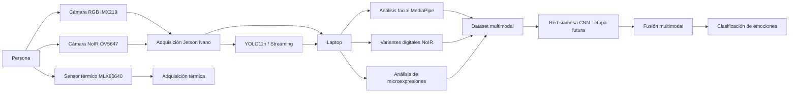
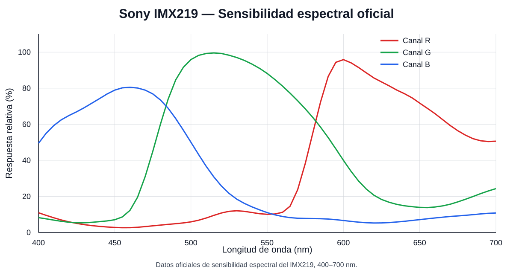
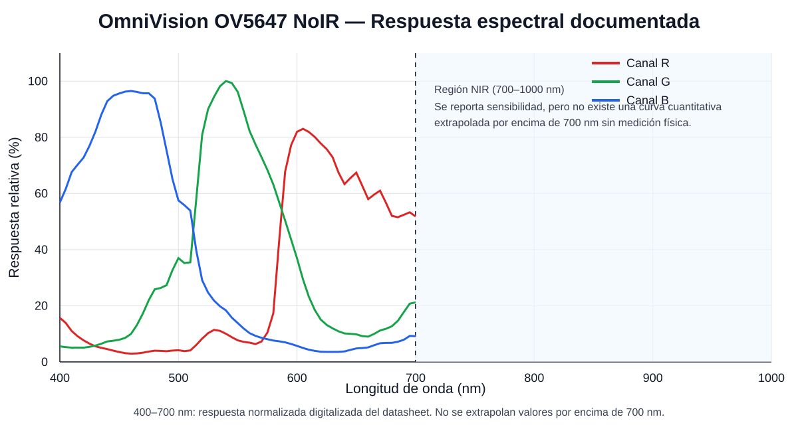
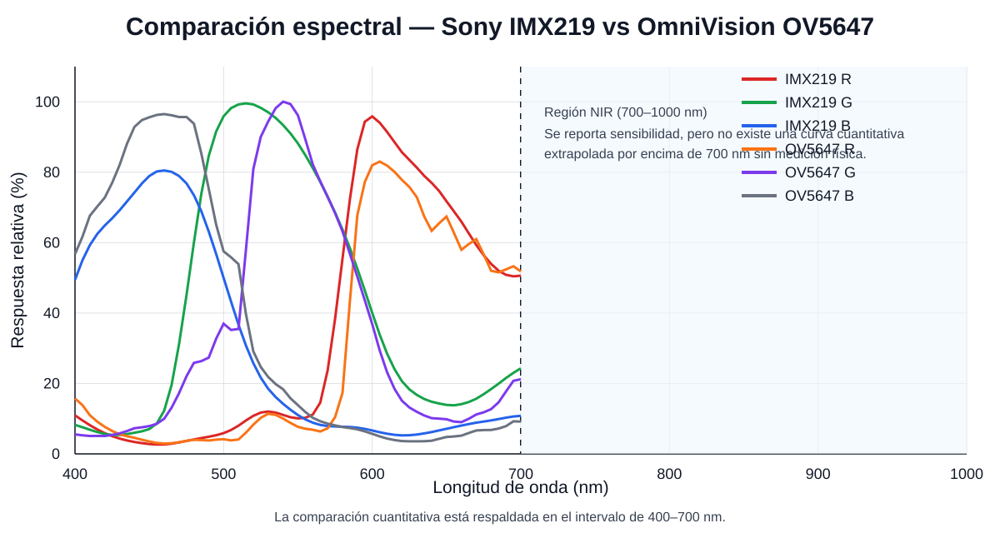
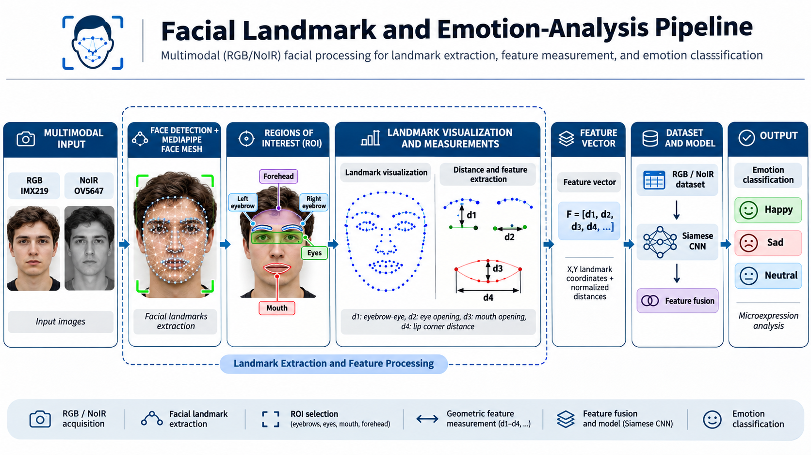
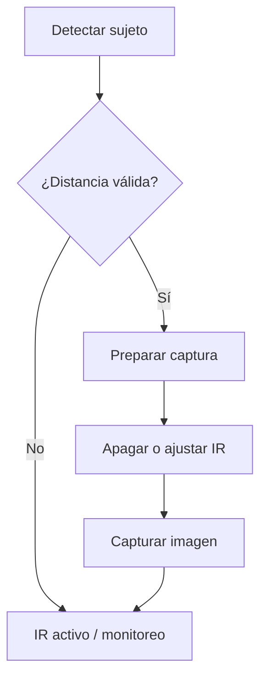
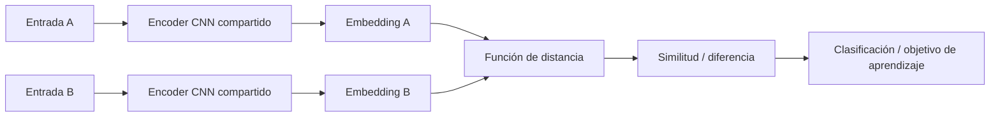

# Clasificación de Video RGB, NoIR y Termográfico mediante Redes Convolucionales Siamesas

## Descripción del proyecto

Este proyecto tiene como objetivo desarrollar un sistema multimodal de inteligencia artificial orientado al análisis de emociones humanas mediante **video RGB, video NoIR e información térmica**. La plataforma experimental integra una cámara **Sony IMX219 RGB**, una cámara **OmniVision OV5647 NoIR**, un sensor térmico **MLX90640** y una **NVIDIA Jetson Nano** para la adquisición y el procesamiento embebido.

La finalidad del sistema es aprovechar información complementaria proveniente de diferentes modalidades. La cámara RGB aporta color, textura y apariencia facial convencional; la cámara NoIR permite extender el análisis hacia el infrarrojo cercano; y el sensor térmico permitirá incorporar información sobre la distribución de temperatura del rostro. La implementación actual se concentra en adquisición de cámaras, detección facial, landmarks, análisis de microexpresiones, detección de objetos con YOLO11n, generación de dataset y control de calidad. El entrenamiento de una arquitectura siamesa multimodal se contempla como una etapa posterior.

> **Estado actual:** la adquisición RGB/NoIR, YOLO11n, MediaPipe, generación de dataset, procesamiento NoIR y control de calidad están implementados. La integración completa del MLX90640 y el entrenamiento final de la red siamesa permanecen como etapas futuras.

---

## Objetivos

### Objetivo general

Desarrollar un sistema multimodal capaz de adquirir y procesar información RGB, NoIR y térmica para apoyar el análisis de emociones humanas mediante redes neuronales convolucionales siamesas.

### Objetivos específicos

- Implementar adquisición de video RGB y NoIR sobre NVIDIA Jetson Nano.
- Integrar el sensor térmico MLX90640.
- Comparar el comportamiento espectral de las cámaras IMX219 y OV5647.
- Detectar rostros y extraer landmarks faciales.
- Analizar distancias geométricas y variaciones asociadas con microexpresiones.
- Crear un dataset propio con imágenes y metadatos.
- Evaluar detección de objetos mediante YOLO11n.
- Conservar imágenes RGB, NoIR y variantes digitales NoIR.
- Aplicar control de calidad al dataset antes del entrenamiento.
- Diseñar una arquitectura multimodal siamesa para etapas posteriores de clasificación.

---

## Hardware utilizado

| Componente | Modelo | Función |
|---|---|---|
| Computadora embebida | NVIDIA Jetson Nano | Adquisición y procesamiento principal |
| Cámara RGB | Sony IMX219 | Captura en espectro visible |
| Cámara NoIR | OmniVision OV5647 | Captura visible + infrarrojo cercano |
| Sensor térmico | MLX90640 | Información térmica facial |
| Sensor de distancia | TFmini | Control de distancia de captura |
| Módulo IR | Iluminación infrarroja externa | Apoyo para la cámara NoIR |
| Laptop | Windows PC | Visualización, MediaPipe y almacenamiento del dataset |

---

## Arquitectura general del sistema



---

## Cámaras utilizadas

### Cámara RGB — Sony IMX219

La Sony IMX219 se utiliza como cámara principal para adquirir información facial en el espectro visible. Esta modalidad permite analizar:

- Color y textura de la piel.
- Geometría de ojos y cejas.
- Movimiento de labios y boca.
- Contorno facial.
- Presencia de lentes.
- Barba.
- Cabello sobre la frente.
- Información visual utilizada por los algoritmos de detección.

### Cámara NoIR — OmniVision OV5647

La OV5647 NoIR se diferencia de una cámara RGB convencional debido a que el módulo no utiliza el mismo filtrado IR-cut. Por ello, puede registrar luz visible y conservar sensibilidad adicional hacia la región del infrarrojo cercano.

La versión aceptada como referencia para el procesamiento NoIR es:

```text
NOIR FILTER LAB v8.1
Archivo: code/tools/noir_interface_v8_1.py
```

Las seis representaciones digitales implementadas son:

1. ORIGINAL NOIR
2. RED BANDPASS VIRTUAL
3. IR-CUT / RGB VIRTUAL
4. BLUE BANDPASS VIRTUAL
5. IR BANDPASS VIRTUAL
6. UV BANDPASS VIRTUAL

> Estas seis salidas son **transformaciones digitales de imagen**. No representan seis filtros espectrales físicos independientes ni crean información espectral nueva. El original NoIR siempre se conserva dentro del dataset.

---

## Curvas espectrales

Las siguientes gráficas utilizan la información espectral más defendible disponible para ambos sensores. Para la IMX219 se utilizan valores publicados de sensibilidad espectral en el rango visible. Para la OV5647 se utiliza información digitalizada y normalizada del datasheet entre 400 y 700 nm. La región NIR por encima de 700 nm se identifica sin inventar una curva cuantitativa donde no existe una medición respaldada.

### Sony IMX219



### OmniVision OV5647 NoIR



### Comparación IMX219 vs OV5647



### Interpretación

- **IMX219 RGB:** se utiliza principalmente para análisis facial convencional en luz visible.
- **OV5647 NoIR:** conserva información visible y sensibilidad adicional hacia el infrarrojo cercano.
- **MLX90640:** pertenece a una modalidad térmica diferente y se procesa de forma separada.

---

## Proceso detallado de landmarks y extracción de características

La siguiente figura representa el flujo completo utilizado como referencia en el proyecto para adquisición RGB/NoIR, detección facial, regiones de interés, mediciones geométricas, construcción del vector de características, dataset y futura clasificación.



### Etapa 1 — Entrada multimodal

Se consideran dos modalidades visuales sincronizadas:

- **RGB IMX219:** información facial convencional en el espectro visible.
- **NoIR OV5647:** información visible con sensibilidad adicional hacia NIR.

El objetivo no es sustituir una modalidad por otra, sino conservar ambas para estudiar diferencias y complementariedad.

### Etapa 2 — Detección facial y MediaPipe Face Mesh

El sistema detecta el rostro y aplica MediaPipe para obtener una representación facial densa. Esta malla sirve como base para seleccionar puntos y regiones faciales estables.

El dataset conserva una representación estructurada de **68 landmarks** para análisis geométrico. Además, cuando están disponibles, el flujo actual de laptop almacena **52 blendshapes faciales**.

### Etapa 3 — Regiones de interés (ROI)

Las principales regiones estudiadas son:

- Frente.
- Ceja izquierda.
- Ceja derecha.
- Ojo izquierdo.
- Ojo derecho.
- Boca.
- Comisuras labiales.

Esto permite medir cambios localizados y no depender únicamente de la imagen completa del rostro.

### Etapa 4 — Visualización de landmarks y mediciones

Cada punto facial se representa como:

$$
p_i=(x_i,y_i)
$$

La distancia euclidiana entre dos landmarks es:

$$
d(p_a,p_b)=\sqrt{(x_a-x_b)^2+(y_a-y_b)^2}
$$

El diagrama resume cuatro mediciones representativas:

| Característica | Ejemplo de interpretación |
|---|---|
| $d_1$ | Distancia ceja-ojo |
| $d_2$ | Apertura del ojo o característica normalizada del ojo |
| $d_3$ | Apertura de boca |
| $d_4$ | Distancia entre comisuras labiales |

El sistema puede incluir otras métricas geométricas normalizadas, por ejemplo EAR, altura de cejas, apertura interna/externa de boca y ancho relativo de sonrisa.

### Etapa 5 — Vector de características

Después de normalizar los valores, se construye un vector:

$$
\mathbf{F}=[d_1,d_2,d_3,d_4,\ldots]
$$

Este vector puede incorporar:

- Coordenadas absolutas.
- Coordenadas normalizadas.
- Distancias geométricas.
- Apertura de ojos.
- Apertura de boca.
- Altura o desplazamiento de cejas.
- Blendshapes.
- Información temporal de microexpresiones.
- Modalidad y metadatos de captura.

### Etapa 6 — Dataset y modelo siamés

Las imágenes y características extraídas se almacenan en el dataset multimodal. Las muestras RGB y NoIR relacionadas con el mismo evento se vinculan mediante identificadores compartidos.

La etapa futura contempla una **red convolucional siamesa** para proyectar muestras en un espacio de características compartido y posteriormente realizar fusión multimodal.

### Etapa 7 — Clasificación de emociones

Las salidas mostradas en el diagrama, como **Feliz, Triste y Neutral**, representan la futura etapa de clasificación una vez completado un protocolo de entrenamiento y validación.

Actualmente el proyecto debe interpretarse principalmente como una **plataforma de adquisición, preprocesamiento, extracción de características y generación de dataset**. Todavía no se afirma que exista un clasificador final validado de emociones.

### Análisis de microexpresiones

El análisis se concentra en variaciones pequeñas y temporales de cejas, ojos, boca, comisuras y otras regiones. Estas series pueden utilizarse posteriormente para estudiar microexpresiones y su relación con las clases emocionales.

---

## Adquisición en Jetson Nano

Las cámaras RGB y NoIR se conectan mediante CSI y utilizan la pila NVIDIA Argus / GStreamer.

Durante el desarrollo se probaron configuraciones como:

- 1280 × 720 @ 30 FPS.
- 1920 × 1080 @ 30 FPS.
- Formato NV12.
- Selección independiente de `sensor-id`.
- Compensación de exposición.
- Ajustes de ganancia.
- Parámetros específicos para NoIR.

Asignación lógica final:

| sensor-id | Sensor | Rol |
|---:|---|---|
| 0 | IMX219 | RGB |
| 1 | OV5647 | NoIR |

El proyecto incluye documentación de una integración personalizada del driver OV5647 y Device Tree para JetPack 4.6.1 / L4T R32.7.1:

```text
drivers/ov5647_noir/
```

---

## Detección facial y landmarks

### Modelo inicial de 68 puntos

Se evaluó inicialmente un esquema de 68 landmarks para representar:

- Mandíbula.
- Ceja izquierda.
- Ceja derecha.
- Nariz.
- Ojo izquierdo.
- Ojo derecho.
- Boca exterior.
- Boca interior.

Este enfoque permitió realizar mediciones geométricas, aunque presentó limitaciones de estabilidad en algunas condiciones de movimiento y NoIR.

### MediaPipe

Posteriormente se integró MediaPipe porque mostró una mayor estabilidad de seguimiento facial. El flujo actual utiliza MediaPipe como fuente principal para análisis facial en laptop y conserva una representación reducida de 68 puntos para almacenar geometría de manera estructurada.

Cuando es posible, también se almacenan **52 blendshapes**.

---

## Análisis de microexpresiones

El proyecto evolucionó desde la captura general de expresiones hacia el análisis de variaciones faciales más pequeñas.

Se monitorizan principalmente:

- Ceja izquierda.
- Ceja derecha.
- Ojos.
- Boca.
- Comisuras.
- Frente.

El sistema registra variaciones temporales que después pueden utilizarse en análisis y entrenamiento.

---

## Detección de objetos con YOLO11n

YOLO11n se ejecuta en la Jetson Nano mediante un servicio local CUDA/Docker.

Archivos principales:

```text
code/main/jetson/JETSON_V11_10_ESTABLE.py
code/main/jetson/yolo11_v9_server_docker.py
```

Configuración del servicio local:

```text
Host: 127.0.0.1
Puerto: 5070
Modelo: yolo11n.pt
Protocolo: FRM2
```

En pruebas iniciales se observaron rendimientos cercanos a **5 FPS**, condicionados por los recursos disponibles y las limitaciones térmicas de la Jetson Nano.

---

## Comunicación Jetson — Laptop

La arquitectura actual separa adquisición y procesamiento de alto nivel:

```text
Cámaras RGB / NoIR
        ↓
   Jetson Nano
        ↓
 YOLO11n / TFmini
        ↓
 Comunicación TCP
        ↓
      Laptop
        ↓
MediaPipe + procesamiento NoIR + Dataset
```

Puertos principales:

| Puerto | Función |
|---:|---|
| 5050 | Compatibilidad / PING-PONG |
| 5051 | Preview y telemetría — FPR8 |
| 5052 | Stream original RGB + NoIR — FORG |
| 5070 | Servicio local Jetson → YOLO — FRM2 |

---

## Dataset propio

La infraestructura actual está basada en **V16.19** y contiene salida estructurada en Excel, imágenes, landmarks, objetos YOLO, variantes NoIR, información de microexpresiones y métricas de calidad.

Por cada evento de captura se pueden guardar hasta **8 canales de imagen**:

1. RGB
2. NOIR
3. NOIR_ORIGINAL
4. NOIR_RED
5. NOIR_IRCUT
6. NOIR_BLUE
7. NOIR_IR
8. NOIR_UV

### Hojas principales del Excel

| Hoja | Información |
|---|---|
| `CAPTURAS` | Metadatos, rutas, calidad, IDs de grupo y canales válidos |
| `PERSONAS` | ID de persona, asociación YOLO, métricas faciales y fuente de landmarks |
| `LANDMARKS` | 68 puntos, coordenadas absolutas/normalizadas e información de outliers |
| `OBJETOS` | Detecciones YOLO |
| `FILTROS_NOIR` | Resultados de cada variante NoIR |
| `MICROEXPRESIONES` | Eventos temporales y series relacionadas con microexpresiones |
| `CALIDAD_DATASET` | Métricas de calidad y recomendación para entrenamiento |

### Identificadores del dataset

- `group_id`: agrupa todas las derivaciones de un mismo evento de captura.
- `subject_group`: identifica a la persona, por ejemplo `P01`, `P02`, `P03`.

Estos campos ayudan a evitar que derivados de una misma captura o de la misma persona se distribuyan incorrectamente entre entrenamiento, validación y prueba.

---

## Representación de landmarks

Cada rostro válido se representa mediante 68 puntos:

$$
L_i=(x_i,y_i), \qquad i=1,2,\ldots,68
$$

La matriz facial se expresa como:

$$
\mathbf{L}\in\mathbb{R}^{68\times2}
$$

Normalización básica respecto al bounding box:

$$
x_i^{norm}=\frac{x_i-x_{face}}{w_{face}}
$$

$$
y_i^{norm}=\frac{y_i-y_{face}}{h_{face}}
$$

El sistema utiliza distintas etapas de recuperación cuando la detección facial es complicada:

```text
LIVE
  ↓
FULL FRAME
  ↓
YOLO ROI
```

Cuando se utiliza un ROI, las coordenadas se transforman nuevamente al sistema de referencia del frame original.

---

## Control de calidad del dataset

V16.19 incorpora control histórico de landmarks mediante rango intercuartílico (IQR).

$$
IQR=Q_3-Q_1
$$

$$
L_{inferior}=Q_1-1.5\,IQR
$$

$$
L_{superior}=Q_3+1.5\,IQR
$$

Una medición se marca como outlier cuando:

$$
x<L_{inferior}\quad \text{o}\quad x>L_{superior}
$$

Porcentaje de outliers:

$$
P_{outlier}=\frac{N_{outlier}}{N_{total}}\times100
$$

Las comparaciones históricas se mantienen separadas por modalidad y por índice de landmark. Por ejemplo, RGB landmark 33 se compara únicamente con datos históricos RGB del landmark 33.

---

## Distancia de captura

El proyecto utiliza un sensor TFmini como apoyo para mantener una distancia consistente.

El rango de trabajo utilizado en la etapa actual es aproximadamente:

```text
30 cm – 60 cm
```

El objetivo es reducir variabilidad geométrica y evitar capturas excesivamente cercanas o alejadas.

---

## Captura de múltiples rostros

El sistema evolucionó para manejar múltiples personas:

1. Detectar varios rostros.
2. Asignar identificadores como `P01`, `P02`, `P03`.
3. Mostrar sujetos detectados.
4. Utilizar una fila de espera.
5. Guardar crops faciales y metadatos.
6. Asociar correctamente cada persona al mismo evento de captura.

---

## Control de iluminación infrarroja

La implementación de Jetson contiene lógica para controlar iluminación IR en función de la condición de captura.



> Un GPIO de la Jetson no debe alimentar directamente el iluminador IR. El pin debe controlar un transistor, MOSFET, relevador o entrada de habilitación adecuada.

---

## Red convolucional siamesa — etapa propuesta

La etapa de aprendizaje final considera redes convolucionales siamesas.



Para dos entradas:

$$
e_A=f_\theta(x_A), \qquad e_B=f_\theta(x_B)
$$

Distancia euclidiana:

$$
D(A,B)=\sqrt{\sum_{i=1}^{n}(e_{A,i}-e_{B,i})^2}
$$

Una formulación de contrastive loss puede expresarse como:

$$
L=yD^2+(1-y)\max(0,m-D)^2
$$

El objetivo es aprender un espacio donde patrones relacionados se encuentren más próximos y patrones distintos estén más separados.

---

## Trabajo de desarrollo realizado

El proyecto ha pasado por diferentes etapas de integración:

1. **Puesta en marcha de cámaras en Jetson**
   - Captura IMX219 RGB mediante CSI / NVIDIA Argus.
   - Integración de OV5647 NoIR mediante driver y Device Tree personalizados.
   - Configuración dual con `sensor-id=0` y `sensor-id=1`.

2. **Adquisición y procesamiento NoIR**
   - Ajuste de exposición y ganancia.
   - Pruebas con iluminación IR externa.
   - Seis representaciones digitales.
   - Selección de **NOIR FILTER LAB v8.1** como versión base.

3. **Experimentos de análisis facial**
   - Pruebas con 68 landmarks.
   - Migración hacia MediaPipe para mejorar estabilidad.
   - Regiones de interés para cejas, ojos, boca y frente.
   - Almacenamiento estructurado de 68 landmarks y blendshapes.

4. **Integración YOLO11n**
   - Detección de objetos y personas.
   - Servicio CUDA/Docker local.
   - Flujo de telemetría con RGB y NoIR.
   - Pruebas de rendimiento sobre Jetson Nano.

5. **Arquitectura distribuida Jetson–Laptop**
   - Adquisición ligera en Jetson.
   - Streaming de preview y originales por TCP.
   - MediaPipe y dataset en laptop.
   - Canales separados para preview, originales e inferencia YOLO.

6. **Generación del dataset**
   - Identificadores P01, P02, P03...
   - Captura multirostro.
   - Imágenes + metadatos.
   - Excel estructurado.
   - RGB, NoIR y variantes NoIR.
   - Distancia de captura.
   - Atributos manuales como lentes, barba y cabello sobre la frente cuando el protocolo lo requiere.

7. **Control de calidad**
   - Verificación de canales válidos.
   - Normalización de landmarks.
   - Detección histórica de outliers mediante IQR.
   - `group_id` y `subject_group` para reducir fuga de datos.

8. **Documentación de reproducibilidad**
   - Instalación del driver OV5647.
   - Device Tree mixto IMX219 + OV5647.
   - Pruebas GStreamer.
   - Entorno documentado de JetPack / L4T / kernel.

---

## Software y tecnologías

Durante el proyecto se han utilizado o evaluado:

- Python.
- OpenCV.
- NVIDIA GStreamer / Argus.
- MediaPipe.
- Ultralytics YOLO11n.
- NumPy.
- OpenPyXL.
- Pillow.
- Sockets TCP.
- UART / comunicación serial.
- Jetson.GPIO.
- CUDA / Docker para inferencia YOLO.
- I²C para la futura integración MLX90640.
- Redes neuronales convolucionales.
- Redes siamesas.
- Visión por computadora.
- Procesamiento digital de imágenes.

---

## Estado actual del proyecto

| Módulo | Estado |
|---|---|
| Captura RGB IMX219 | ✅ Funcional |
| Captura NoIR OV5647 | ✅ Funcional |
| Dos cámaras CSI | ✅ Funcional |
| Driver / Device Tree OV5647 | ✅ Implementado en el entorno del proyecto |
| NOIR FILTER LAB v8.1 | ✅ Versión de referencia |
| YOLO11n | ✅ Probado |
| MediaPipe | ✅ Implementado |
| Representación estructurada de 68 landmarks | ✅ Implementada |
| 52 blendshapes | ✅ Implementados cuando están disponibles |
| Análisis de microexpresiones | ✅ Integrado en el flujo de adquisición |
| Dataset V16.19 | ✅ Infraestructura estable |
| Control de calidad IQR | ✅ Implementado |
| Captura multirostro | 🟡 En desarrollo continuo |
| Control automático IR | 🟡 En pruebas |
| Integración MLX90640 | 🟡 Pendiente / etapa futura |
| Entrenamiento siamés | ⏳ Etapa futura |
| Fusión multimodal final | ⏳ Etapa futura |
| Clasificador final de emociones | ⏳ Etapa futura |

---

## Estructura del repositorio

```text
.
├── README.md
├── RUN.md
├── CODE_STATUS.md
├── code/
│   ├── main/
│   │   ├── jetson/
│   │   │   ├── JETSON_V11_10_ESTABLE.py
│   │   │   └── yolo11_v9_server_docker.py
│   │   └── laptop/
│   │       ├── V19.py
│   │       └── V19_COMANDOS.txt
│   └── tools/
│       └── noir_interface_v8_1.py
├── drivers/
│   └── ov5647_noir/
│       ├── README_DRIVER.md
│       ├── config/
│       ├── install/
│       ├── source/
│       └── tests/
└── docs/
    ├── curva_espectral_IMX219_cientifica.svg
    ├── curva_espectral_OV5647_NoIR_cientifica.svg
    ├── comparacion_espectral_IMX219_OV5647_cientifica.svg
    └── proceso_landmarks_visualizacion.png
```

---

## Ejecución del proyecto

Consultar:

- [RUN.md](RUN.md)
- [CODE_STATUS.md](CODE_STATUS.md)

Las versiones funcionales del código se conservaron sin reescribir su lógica para evitar introducir diferencias respecto a los archivos utilizados durante las pruebas.

---

## Documentación del driver OV5647

La integración del OV5647 NoIR en la Jetson Nano requirió un driver y Device Tree personalizados para el entorno utilizado durante el desarrollo.

Documentación disponible:

- [Documentación del driver OV5647](drivers/ov5647_noir/README_DRIVER.md)
- [Notas de instalación](drivers/ov5647_noir/install/INSTALLATION.md)
- [Estado de los archivos fuente](drivers/ov5647_noir/source/README_SOURCE_STATUS.md)

Entorno documentado:

```text
NVIDIA Jetson Nano
JetPack 4.6.1
L4T R32.7.1
Kernel 4.9.253-tegra
Arquitectura: aarch64
```

---

## Próximas etapas

- Completar la integración del MLX90640.
- Sincronizar adquisición RGB, NoIR y térmica.
- Aumentar tamaño y diversidad del dataset.
- Refinar etiquetas y protocolo de microexpresiones.
- Mejorar control de iluminación IR.
- Entrenar el encoder visual.
- Entrenar la arquitectura siamesa.
- Integrar características RGB, NoIR, térmicas, landmarks y blendshapes.
- Evaluar accuracy, precision, recall, F1 y matrices de confusión.
- Medir latencia, FPS y comportamiento térmico en Jetson Nano.

---

## Alcance científico

Este repositorio documenta una plataforma experimental de adquisición multimodal y desarrollo de inteligencia artificial. El sistema actual no debe interpretarse como un clasificador clínicamente validado de emociones. Las gráficas espectrales se presentan como datos técnicos de referencia y no se extrapola cuantitativamente la respuesta NIR cuando no existe una medición calibrada disponible.

---

## Autor

Proyecto de residencia profesional enfocado en inteligencia artificial, visión por computadora, procesamiento embebido, adquisición multimodal y análisis de emociones humanas.
