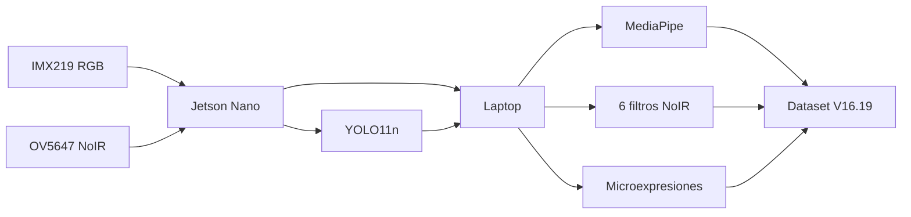

# Clasificación multimodal RGB, NoIR y termográfica mediante redes convolucionales siamesas

> Proyecto de residencia profesional orientado a la adquisición multimodal de información facial y al desarrollo posterior de un modelo de inteligencia artificial para aprender representaciones de patrones faciales.

## Estado del proyecto

**Estado actual:** infraestructura de adquisición y dataset **V16.19** estable.

### Implementado

- Adquisición RGB con cámara IMX219.
- Adquisición NoIR con cámara OV5647.
- NVIDIA Jetson Nano como plataforma de adquisición.
- YOLO11n para detección de personas.
- MediaPipe Face Landmarker.
- Representación reducida de **68 landmarks**.
- **52 blendshapes** faciales.
- Análisis temporal de candidatos a microexpresiones.
- Seis representaciones digitales NoIR.
- Dataset estructurado en Excel.
- Asociación uno-a-uno de rostros con `P01`, `P02`, ...
- Fallback de landmarks: LIVE -> frame completo -> ROI YOLO.
- Control de calidad por canales.
- Detección de outliers mediante IQR.
- `group_id` y `subject_group` para evitar contaminación entre conjuntos.

### Pendiente

- Recolección definitiva de un dataset amplio.
- Integración de la cámara térmica MLX90640.
- Entrenamiento del encoder ResNet-18.
- Entrenamiento siamés multimodal.
- Integración de landmarks, blendshapes y microexpresiones en la red.
- Transferencia semántica desde datasets emocionales públicos.
- Evaluación final: accuracy, precision, recall, F1 y matriz de confusión.

---

## Arquitectura actual



## Modalidades registradas

Por cada evento se almacenan hasta **8 imágenes**:

1. RGB original.
2. NoIR original.
3. NOIR_ORIGINAL.
4. NOIR_RED.
5. NOIR_IRCUT.
6. NOIR_BLUE.
7. NOIR_IR.
8. NOIR_UV.

> Los seis filtros NoIR son **transformaciones digitales** derivadas de la misma captura NoIR; no son seis filtros espectrales físicos independientes.

---

## Estructura del dataset

| Hoja | Información |
|---|---|
| `CAPTURAS` | Metadatos, calidad, rutas, `group_id`, canales válidos |
| `PERSONAS` | Pxx, YOLO, rostro, métricas, fuente de landmarks |
| `LANDMARKS` | 68 puntos, coordenadas absolutas y normalizadas, outliers |
| `OBJETOS` | Detecciones YOLO |
| `FILTROS_NOIR` | Resultados por cada variante NoIR |
| `MICROEXPRESIONES` | Eventos y series temporales |
| `CALIDAD_DATASET` | Calidad, validez y recomendación de entrenamiento |

### Identificadores

- `group_id`: agrupa todos los derivados de una misma captura.
- `subject_group`: identifica a la persona (`P01`, `P02`, ...).

Estos campos se utilizarán para que una misma captura o sujeto no contamine simultáneamente `train`, `validation` y `test`.

---

## Landmarks

Cada rostro válido se representa mediante 68 puntos:

$$
L_i=(x_i,y_i), \qquad i=1,2,\ldots,68
$$

Matriz facial:

$$
\mathbf{L}\in\mathbb{R}^{68\times 2}
$$

Normalización básica respecto a la caja facial:

$$
x_i^{norm}=\frac{x_i-x_{face}}{w_{face}}
$$

$$
y_i^{norm}=\frac{y_i-y_{face}}{h_{face}}
$$

El landmarker utiliza tres niveles de recuperación:

```text
LIVE
  ↓
FRAME COMPLETO
  ↓
ROI YOLO
```

Cuando se utiliza ROI, los puntos son remapeados al sistema de coordenadas del frame original.

---

## Control de outliers mediante IQR

$$
IQR = Q_3-Q_1
$$

$$
L_{inf}=Q_1-1.5\,IQR
$$

$$
L_{sup}=Q_3+1.5\,IQR
$$

Una observación se marca como atípica cuando:

$$
x<L_{inf}\quad \text{o}\quad x>L_{sup}
$$

Porcentaje de outliers:

$$
P_{outlier}=\frac{N_{outlier}}{N_{total}}\times100
$$

El historial se mantiene separado por modalidad y landmark.

---

# Modelo propuesto

## Encoder visual

Se propone iniciar con **ResNet-18** debido a su menor costo computacional respecto a ResNet-34.

```text
Imagen RGB / NoIR / filtro
          ↓
      ResNet-18
          ↓
        512
          ↓
   Linear 512→256
   BatchNorm + GELU
          ↓
   Linear 256→128
   BatchNorm + GELU
          ↓
   Linear 128→64
          ↓
   Normalización L2
          ↓
    Embedding 64D
```

### Matrices

Salida de ResNet-18:

$$
\mathbf{z}\in\mathbb{R}^{512}
$$

Primera capa:

$$
\mathbf{h}_1=GELU(BN(W_1\mathbf{z}+b_1))
$$

$$
W_1\in\mathbb{R}^{256\times512}
$$

Segunda capa:

$$
\mathbf{h}_2=GELU(BN(W_2\mathbf{h}_1+b_2))
$$

$$
W_2\in\mathbb{R}^{128\times256}
$$

Tercera capa:

$$
\mathbf{e}=W_3\mathbf{h}_2+b_3
$$

$$
W_3\in\mathbb{R}^{64\times128}
$$

Normalización L2:

$$
\hat{\mathbf{e}}=\frac{\mathbf{e}}{\|\mathbf{e}\|_2}
$$

---

## Red siamés

Dos modalidades del mismo evento se procesan con **pesos compartidos**:

$$
e_A=f_\theta(x_A), \qquad e_B=f_\theta(x_B)
$$

Distancia euclidiana:

$$
D(A,B)=\sqrt{\sum_{i=1}^{64}(e_{A,i}-e_{B,i})^2}
$$

Contrastive loss:

$$
L=yD^2+(1-y)\max(0,m-D)^2
$$

El objetivo es aprender un espacio latente donde representaciones relacionadas estén próximas.

> **Importante:** una captura diferente no implica necesariamente una emoción diferente. La construcción de pares negativos deberá realizarse de manera controlada.

---

## Matriz de embeddings

Para un batch de tamaño `B`:

$$
E\in\mathbb{R}^{B\times64}
$$

Cada fila contiene un embedding aprendido para una muestra.

## Matriz de distancias

$$
D_{ij}=\|e_i-e_j\|_2
$$

Esta matriz permitirá analizar similitud entre RGB, NoIR y sus variantes.

---

# ¿Cómo se reconocerán felicidad, tristeza o neutralidad?

El dataset propio no obliga al operador a etiquetar manualmente cada captura con una emoción.

Sin embargo, un modelo sin referencias semánticas puede aprender **clusters**, pero no sabe que un cluster debe llamarse `Happiness`, `Sadness` o `Neutral`.

La estrategia propuesta es:

```text
RAF-DB / AffectNet
        ↓
Aprendizaje semántico de expresiones
        ↓
ResNet-18
        ↓
Transferencia al dominio RGB propio
        ↓
RGB como referencia semántica
        ↓
Alineación RGB ↔ NoIR mediante aprendizaje multimodal
```

La salida final podrá representarse mediante una distribución de probabilidades:

$$
P(y=k\mid x)=\frac{e^{z_k}}{\sum_j e^{z_j}}
$$

$$
\hat y=\arg\max_k P(y=k\mid x)
$$

Ejemplo **ilustrativo**:

| Expresión | Probabilidad |
|---|---:|
| Happiness | 78.4 % |
| Neutral | 8.1 % |
| Surprise | 4.1 % |
| Sadness | 3.2 % |
| Anger | 2.6 % |
| Disgust | 1.9 % |
| Fear | 1.7 % |

> Los valores anteriores son un ejemplo del formato de salida deseado, no resultados experimentales actuales.

---

# Evaluación prevista

El entrenamiento deberá mostrar disminución simultánea de pérdida de entrenamiento y validación.

Métricas de clasificación futuras:

$$
Accuracy=\frac{TP+TN}{TP+TN+FP+FN}
$$

$$
Precision=\frac{TP}{TP+FP}
$$

$$
Recall=\frac{TP}{TP+FN}
$$

$$
F1=2\frac{Precision\cdot Recall}{Precision+Recall}
$$

También se generarán:

- Curvas `Train Loss` vs `Validation Loss`.
- Matriz de confusión.
- Matriz de distancias.
- Distribución de embeddings.
- Clusters.
- Boxplots / IQR por patrón o clase.
- Comparaciones RGB vs NoIR.

---

# Recolección recomendada

Antes del entrenamiento definitivo:

1. Capturar una sola persona física por identificador Pxx.
2. Realizar múltiples sesiones por persona.
3. Permitir expresiones y movimientos naturales.
4. Conservar condiciones como lentes, barba y cabello en frente.
5. Priorizar muestras con mayor número de canales válidos.
6. No eliminar automáticamente muestras de baja calidad; mantenerlas documentadas y excluirlas mediante metadatos.
7. Dividir `train`, `validation` y `test` respetando `group_id` y `subject_group`.

---

# Ejecución

Los nombres y comandos concretos pueden cambiar según la versión del código. La configuración actual utiliza tres servicios principales para dataset, preview y stream original.

Ejemplo conceptual de túnel:

```bash
ssh -N \
  -R 5050:127.0.0.1:5050 \
  -R 5051:127.0.0.1:5051 \
  -R 5052:127.0.0.1:5052 \
  <usuario>@<host-jetson>
```

> No publicar direcciones IP, contraseñas ni credenciales reales en el repositorio.

---

# Referencias

1. He, K., Zhang, X., Ren, S., & Sun, J. **Deep Residual Learning for Image Recognition**. https://arxiv.org/abs/1512.03385
2. PyTorch. **Defining a Neural Network in PyTorch**. https://docs.pytorch.org/tutorials/recipes/recipes/defining_a_neural_network.html
3. TorchVision. **ResNet-18**. https://docs.pytorch.org/vision/main/models/generated/torchvision.models.resnet18.html
4. Google AI. **MediaPipe Face Landmarker**. https://ai.google.dev/edge/mediapipe/solutions/vision/face_landmarker
5. Ultralytics. **YOLO11**. https://docs.ultralytics.com/models/yolo11/
6. Juárez-Jiménez et al. **Facial Landmark Visualization and Emotion Recognition Through Neural Networks**. https://arxiv.org/abs/2506.17191
7. Li et al. **RAF-DB / Reliable Crowdsourcing and Deep Locality-Preserving Learning for Expression Recognition in the Wild**. https://openaccess.thecvf.com/content_cvpr_2017/html/Li_Reliable_Crowdsourcing_and_CVPR_2017_paper.html
8. Mollahosseini et al. **AffectNet**. https://arxiv.org/abs/1708.03985

---

## Nota

Este repositorio se encuentra en fase de investigación y desarrollo. Las categorías emocionales deben interpretarse como **expresiones faciales compatibles con clases aprendidas**, no como una medición infalible del estado emocional interno de una persona.
