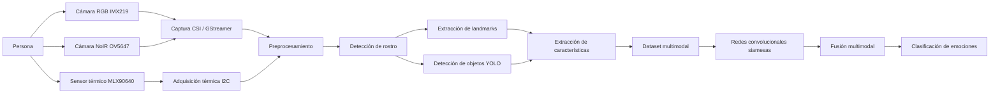
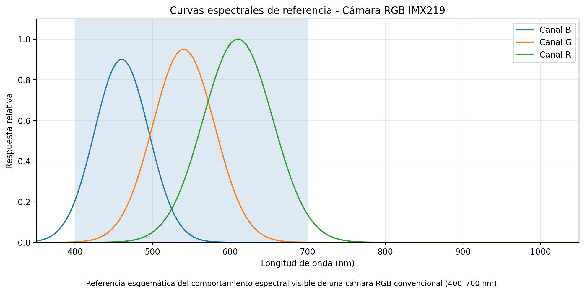
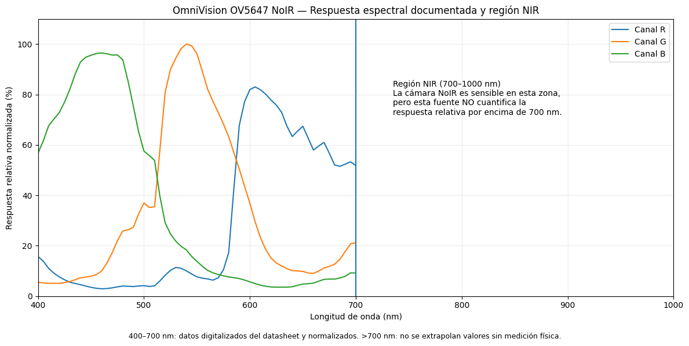
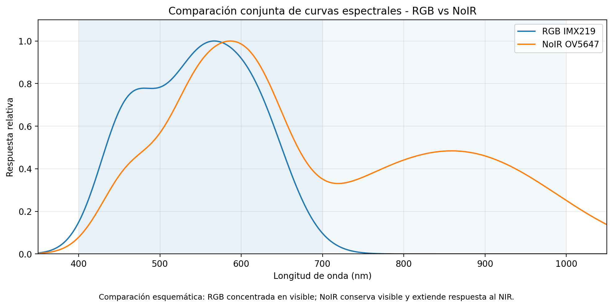
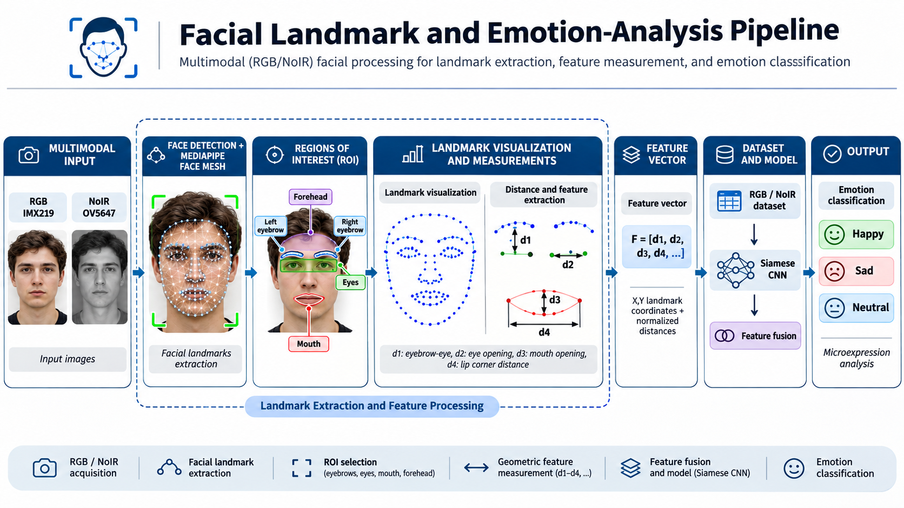
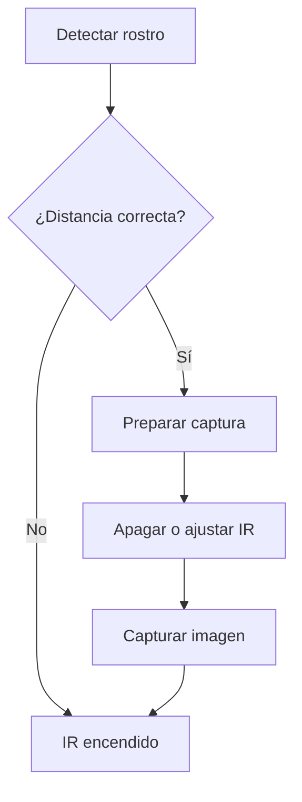
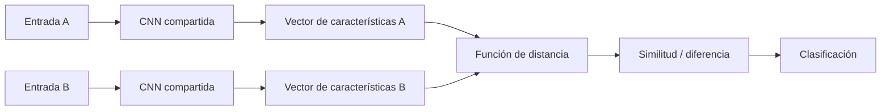

# Clasificación de Video RGB, NoIR y Termográfico mediante Redes Convolucionales Siamesas

## Descripción del proyecto

Este proyecto tiene como objetivo desarrollar un sistema de inteligencia artificial orientado al reconocimiento de emociones humanas mediante el análisis multimodal de video RGB, video NoIR e información térmica. La propuesta integra una cámara RGB **IMX219**, una cámara **NoIR OV5647** y un sensor térmico **MLX90640**, montados sobre una **NVIDIA Jetson Nano**, con el fin de capturar, procesar y analizar información facial desde diferentes modalidades.

La motivación principal del trabajo es aprovechar las ventajas de cada sensor. La cámara RGB permite analizar color, textura facial y rasgos visibles; la cámara NoIR permite extender el análisis hacia el infrarrojo cercano; y el sensor térmico permite obtener información relacionada con la distribución de temperatura en el rostro. A partir de esta información, se construye un sistema experimental enfocado en la detección de rasgos faciales, landmarks, microexpresiones, y el posterior entrenamiento de redes convolucionales siamesas para la clasificación de emociones.

---

## Objetivos

### Objetivo general

Desarrollar un sistema multimodal capaz de adquirir y procesar información RGB, NoIR y térmica para apoyar el análisis de emociones humanas mediante redes convolucionales siamesas.

### Objetivos específicos

- Implementar la adquisición de video RGB y NoIR sobre NVIDIA Jetson Nano.
- Integrar un sensor térmico MLX90640 al sistema.
- Comparar el comportamiento espectral de la cámara RGB IMX219 y la cámara NoIR OV5647.
- Detectar rostros y extraer landmarks faciales.
- Analizar distancias entre landmarks y microexpresiones.
- Construir un dataset propio con imágenes y metadatos.
- Evaluar detección de objetos utilizando YOLO11n.
- Diseñar una arquitectura de fusión multimodal para futuras etapas de clasificación.

---

## Hardware utilizado

| Componente | Modelo | Función |
|---|---|---|
| Computadora embebida | NVIDIA Jetson Nano | Procesamiento del sistema |
| Cámara RGB | Sony IMX219 | Captura en espectro visible |
| Cámara NoIR | OmniVision OV5647 | Captura visible + infrarrojo cercano |
| Sensor térmico | MLX90640 | Captura de información térmica |
| Módulo IR | Iluminación infrarroja | Apoyo para la cámara NoIR |
| Laptop | Equipo auxiliar | Visualización, monitoreo y pruebas |

---

## Arquitectura general del sistema



---

## Cámaras utilizadas

### Cámara RGB – Sony IMX219

La cámara RGB IMX219 se emplea para capturar información visible del rostro. Esta modalidad es útil para observar color, textura de piel, forma de ojos, cejas, labios, barba, lentes y cabello en la frente. En este proyecto, la cámara RGB actúa como la referencia principal para el análisis visual convencional.

### Cámara NoIR – OmniVision OV5647

La cámara NoIR OV5647 se diferencia de una cámara RGB convencional en que no incorpora un filtro de corte infrarrojo. Debido a ello, además de captar luz visible, puede registrar una parte del infrarrojo cercano. Esta característica la vuelve útil para comparar cómo cambian ciertos rasgos faciales bajo diferentes condiciones de iluminación y para explorar información complementaria al espectro visible.

La versión de referencia tomada para las pruebas de esta cámara es:

```text
NOIR FILTER LAB v8.1
Archivo: noir_interface_v8_1.py
```

---

## Curvas espectrales de las cámaras

En esta sección se muestran las curvas espectrales de referencia utilizadas para representar el comportamiento general de las cámaras involucradas en el proyecto. Estas curvas **no corresponden a una calibración radiométrica experimental**, sino a una representación técnica y esquemática del rango de trabajo de cada sensor.

### 1. Curva espectral de la cámara RGB IMX219

La cámara RGB concentra su respuesta en la región visible del espectro, aproximadamente entre **400 nm y 700 nm**.



### 2. Curva espectral de la cámara NoIR OV5647

La cámara NoIR conserva la respuesta en la región visible y además presenta sensibilidad en el **infrarrojo cercano**, extendiéndose aproximadamente hasta **1000 nm**.



### 3. Curvas espectrales comparativas de ambas cámaras

La siguiente gráfica muestra ambas respuestas en conjunto, permitiendo visualizar con claridad que la cámara RGB se concentra en el visible, mientras que la cámara NoIR extiende su sensibilidad hacia el NIR.



### Interpretación

- **RGB IMX219:** adecuada para analizar rasgos visibles del rostro.
- **NoIR OV5647:** adecuada para analizar rasgos visibles y componentes en el infrarrojo cercano.
- **MLX90640:** no se representa con estas curvas, ya que pertenece al dominio térmico y se analiza como una modalidad separada.

---

## Proceso de extracción y visualización de landmarks

Como parte del flujo experimental del proyecto, se trabaja con un proceso de análisis facial que incluye la entrada de imágenes, la extracción de landmarks, la visualización de la geometría facial y el cálculo de distancias entre puntos de interés.



### Descripción del proceso

1. **Input Images:** se capturan imágenes del rostro desde las cámaras RGB o NoIR.
2. **Landmark extraction:** se detectan puntos faciales relevantes en regiones como ojos, cejas, nariz, boca y contorno.
3. **Visualization of facial landmarks:** se representa gráficamente la distribución de los puntos detectados para facilitar el análisis.
4. **Distance between landmarks:** se calculan distancias entre puntos faciales clave, permitiendo cuantificar cambios asociados con expresiones o microexpresiones.

Este flujo es importante porque permite convertir información visual del rostro en variables medibles, las cuales posteriormente pueden emplearse en el entrenamiento de modelos de aprendizaje profundo.

---

## Captura y procesamiento en Jetson Nano

Las cámaras RGB y NoIR fueron conectadas a la Jetson Nano mediante interfaz **CSI**. Durante las pruebas se utilizaron configuraciones de GStreamer con resoluciones como:

- 1280 × 720 a 30 FPS
- 1920 × 1080 a 30 FPS
- Formato NV12
- Ajustes de ganancia
- Compensación de exposición
- Selección independiente de `sensor-id`

Se realizaron pruebas individuales y simultáneas con ambas cámaras para comparar su comportamiento y su utilidad en el análisis facial.

---

## Detección facial y extracción de rasgos

Se evaluaron diferentes técnicas para la detección de rostro y extracción de rasgos:

### Modelo de 68 puntos
Se utilizó inicialmente un modelo de 68 landmarks para localizar cejas, ojos, nariz, boca y contorno facial. Aunque fue útil como punto de partida, presentó limitaciones de estabilidad en algunas capturas, especialmente en NoIR.

### MediaPipe
Posteriormente se implementaron pruebas con **MediaPipe**, observándose un mejor seguimiento facial. Esta alternativa se consideró más estable para continuar el análisis de cejas, boca y microexpresiones.

---

## Microexpresiones

Una de las orientaciones más importantes del proyecto es el análisis de **microexpresiones faciales**. Para ello se monitorean pequeñas variaciones en regiones como:

- Ceja izquierda
- Ceja derecha
- Ojos
- Boca
- Comisuras labiales
- Frente

Estas variaciones permiten construir descriptores más finos del comportamiento emocional del usuario.

---

## Detección de objetos con YOLO11n

También se realizaron pruebas utilizando **YOLO11n** en la Jetson Nano con el objetivo de verificar la viabilidad de combinar:

- Captura de cámaras
- Detección de objetos
- Detección facial
- Comunicación con una laptop

En las primeras pruebas se obtuvo un rendimiento cercano a **5 FPS**, por lo que se contemplan optimizaciones posteriores para mejorar desempeño térmico y velocidad de inferencia.

---

## Dataset propio

El proyecto contempla la creación de un conjunto de datos propio con imágenes y metadatos. Entre los campos considerados se encuentran:

| Campo | Descripción |
|---|---|
| Persona | Identificador del sujeto (P01, P02, etc.) |
| Cámara | RGB o NoIR |
| Microexpresión | Expresión o gesto registrado |
| Ceja izquierda | Rasgos de la región |
| Ceja derecha | Rasgos de la región |
| Boca | Rasgos de la región |
| Lentes | Sí / No |
| Barba | Sí / No |
| Cabello en frente | Sí / No |
| Distancia | Distancia de captura |
| Filtro | Filtro aplicado |
| Coordenadas | Información X/Y de landmarks |
| Imagen | Captura asociada |

También se realizaron pruebas para almacenar imágenes directamente en archivos de Excel alineadas con su información correspondiente.

---

## Distancia de captura

Para estandarizar el conjunto de datos, se trabajó con un rango aproximado de captura entre:

```text
30 cm – 60 cm
```

Esto permite mejorar la consistencia de las muestras y evita registrar rostros demasiado pequeños o demasiado cercanos.

---

## Captura de múltiples rostros

El sistema también evolucionó hacia la detección de múltiples rostros, incluyendo un flujo de trabajo con miniaturas y fila de espera para capturar hasta tres personas por tanda. Esto resulta útil para aumentar el dataset y analizar escenarios con varias personas.

---

## Control de iluminación infrarroja

Se realizaron pruebas para controlar un módulo IR mediante comunicación serial. La lógica de funcionamiento propuesta consiste en:



---

## Redes convolucionales siamesas

La etapa final del proyecto considera el uso de redes siamesas para comparar patrones faciales y térmicos.



Una medida básica de comparación puede expresarse como:

$$
d(x_1,x_2)=\left\|f(x_1)-f(x_2)\right\|_2
$$

donde:

- $x_1$ y $x_2$ son muestras de entrada.
- $f(x)$ representa la extracción de características.
- $d$ representa la distancia entre representaciones obtenidas.

---

## Estado actual del proyecto

| Módulo | Estado |
|---|---|
| Captura RGB | ✅ Funcional |
| Captura NoIR | ✅ Funcional |
| Dos cámaras CSI | ✅ Detectadas |
| Filtros NoIR | ✅ Implementados |
| NOIR FILTER LAB v8.1 | ✅ Base actual |
| MediaPipe | ✅ Probado |
| YOLO11n | ✅ Probado |
| Dataset propio | 🟡 En desarrollo |
| Captura multirostro | 🟡 En desarrollo |
| Control IR | 🟡 En pruebas |
| Integración MLX90640 | 🟡 En desarrollo |
| Entrenamiento siamés | ⏳ Etapa posterior |
| Fusión multimodal | ⏳ Etapa posterior |
| Clasificación de emociones | ⏳ Etapa posterior |

---

## Estructura recomendada del repositorio

```text
tu-repositorio/
│
├── README.md
│
├── docs/
│   ├── curva_espectral_rgb_imx219.png
│   ├── curva_espectral_noir_ov5647.png
│   ├── curvas_espectrales_rgb_noir_comparativa.png
│   └── proceso_landmarks_visualizacion.png
│
├── jetson/
├── dataset/
├── models/
└── results/
```

---

## Próximas etapas

- Finalizar la integración del MLX90640.
- Sincronizar RGB, NoIR y térmica.
- Completar el dataset multimodal.
- Mejorar el control automático del IR.
- Definir clases de microexpresiones.
- Entrenar redes siamesas.
- Integrar la fusión multimodal.
- Evaluar precisión, FPS y tiempo de inferencia.

---

## Autor

Proyecto de residencia profesional enfocado en inteligencia artificial, visión por computadora, procesamiento multimodal y reconocimiento de emociones humanas.
